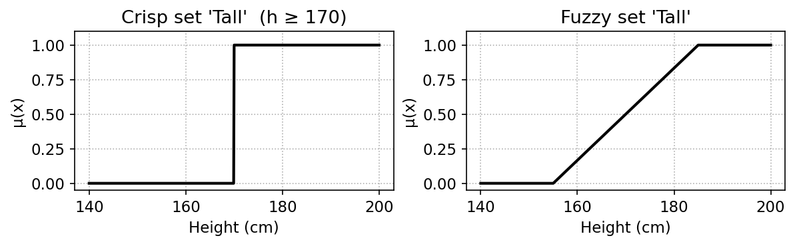
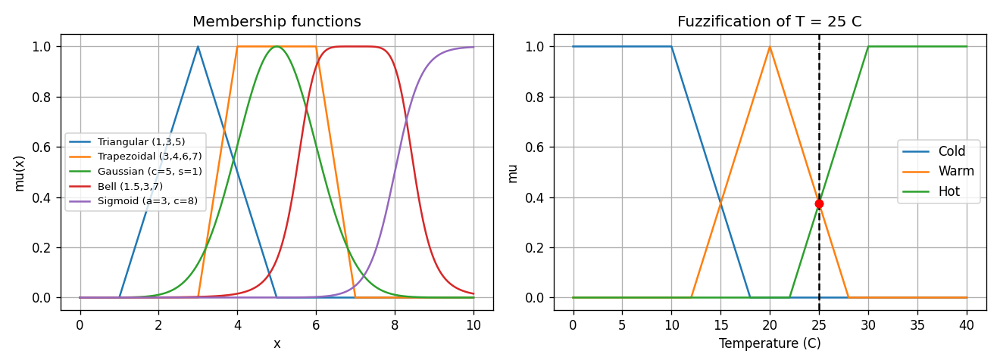
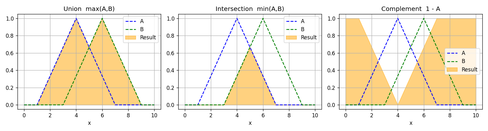
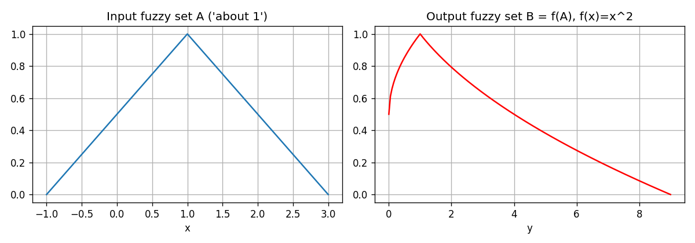
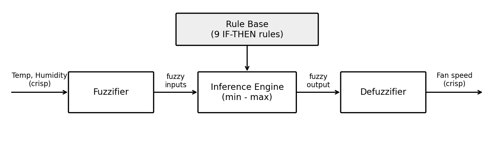
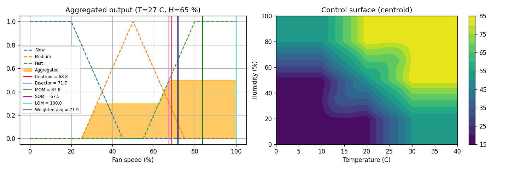
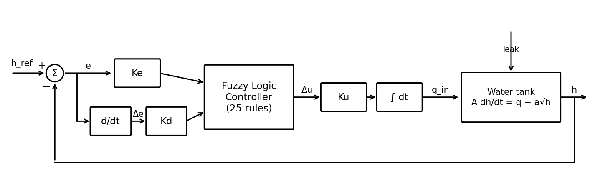
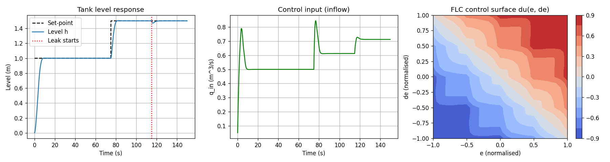
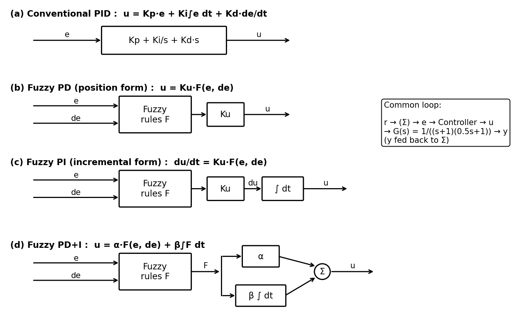
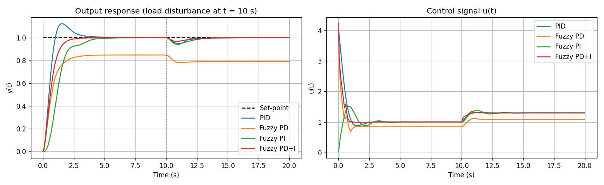

<div class="cover">

# PRACTICAL FILE
## ECT423 – Fuzzy Logic Applications

**Name:** ______________________ &nbsp;&nbsp; **Roll No.:** ______________

**Branch / Semester:** ______________________ &nbsp;&nbsp; **Session:** ______________

**Software used:** Python 3.12, NumPy, Matplotlib

### INDEX

| S.No. | Name of the Experiment | Date | Page No. | Sign |
|:---:|---|:---:|:---:|:---:|
| 1 | To understand crisp sets, fuzzy sets, membership functions and the process of fuzzification | | | |
| 2 | To implement and verify basic operations on fuzzy sets and study their properties | | | |
| 3 | To construct fuzzy relations and perform composition operations used in approximate reasoning | | | |
| 4 | To understand and implement the fuzzy extension principle for mapping fuzzy input sets to fuzzy output sets | | | |
| 5 | To design a basic fuzzy inference system and evaluate different defuzzification methods | | | |
| 6 | To design a complete fuzzy logic controller and study its response for a practical control problem | | | |
| 7 | To design and compare different fuzzy controller structures with a conventional PID controller | | | |

</div>

<div class="newpage"></div>

# EXPERIMENT – 1
## Crisp Sets, Fuzzy Sets, Membership Functions and Fuzzification

### AIM
To understand crisp sets, fuzzy sets, membership functions and the process of fuzzification using Python.

### THEORY

**1. Crisp set:** An element either belongs to the set or it does not. It is described by a *characteristic function*
$$\chi_A(x)=\begin{cases}1, & x\in A\\0, & x\notin A\end{cases}$$
The boundary is sharp. For example, Tall = {h ≥ 170 cm} makes 169.9 cm "not tall" but 170 cm "tall".

**2. Fuzzy set:** An element can belong *partially*. A fuzzy set $A$ on universe $X$ is
$$A=\{(x,\ \mu_A(x))\mid x\in X\},\qquad \mu_A:X\to[0,1]$$
For a discrete universe it is written $A=\sum \mu_A(x_i)/x_i$. The boundary is gradual, so it can model vague words such as *tall*, *hot* or *fast*.



**3. Properties of a fuzzy set**

- Support: $\{x \mid \mu_A(x)>0\}$  ·  Core: $\{x \mid \mu_A(x)=1\}$
- Height: $\max_x \mu_A(x)$; the set is *normal* if height = 1
- Crossover points: $\mu_A(x)=0.5$  ·  α-cut: $A_\alpha=\{x \mid \mu_A(x)\ge\alpha\}$

**4. Common membership functions (MF)**

| MF | Formula |
|---|---|
| Triangular $(a,b,c)$ | $\max\big(\min(\frac{x-a}{b-a},\frac{c-x}{c-b}),0\big)$ |
| Trapezoidal $(a,b,c,d)$ | $\max\big(\min(\frac{x-a}{b-a},1,\frac{d-x}{d-c}),0\big)$ |
| Gaussian $(c,\sigma)$ | $e^{-\frac{1}{2}\left(\frac{x-c}{\sigma}\right)^2}$ |
| Generalised bell $(a,b,c)$ | $\dfrac{1}{1+\left|\frac{x-c}{a}\right|^{2b}}$ |
| Sigmoid $(a,c)$ | $\dfrac{1}{1+e^{-a(x-c)}}$ |

**5. Fuzzification:** This converts a crisp input value into membership grades of the linguistic terms defined on that input. For example, with Cold, Warm and Hot on 0–40 °C, the input T = 25 °C gives μ_Warm = 0.375 and μ_Hot = 0.375. One crisp value can belong to two overlapping sets at the same time. This is the first stage of every fuzzy system.

### PYTHON CODE
```python
# Experiment 1: Crisp sets, fuzzy sets, membership functions and fuzzification
import numpy as np
import matplotlib
matplotlib.use("Agg")
import matplotlib.pyplot as plt

# ---------------- Membership functions ----------------
def trimf(x, a, b, c):                      # triangular
    return np.maximum(np.minimum((x - a) / (b - a), (c - x) / (c - b)), 0)

def trapmf(x, a, b, c, d):                  # trapezoidal
    return np.clip(np.minimum((x - a) / (b - a), (d - x) / (d - c)), 0, 1)

def gaussmf(x, c, s):                       # gaussian
    return np.exp(-0.5 * ((x - c) / s) ** 2)

def gbellmf(x, a, b, c):                    # generalised bell
    return 1 / (1 + np.abs((x - c) / a) ** (2 * b))

def sigmf(x, a, c):                         # sigmoidal
    return 1 / (1 + np.exp(-a * (x - c)))

# ---------------- Part A : crisp set vs fuzzy set ----------------
heights = np.array([150, 160, 165, 170, 175, 180, 190])
crisp_tall = (heights >= 170).astype(int)            # sharp boundary
fuzzy_tall = trapmf(heights, 155, 185, 250, 251)     # gradual boundary

print("PART A : Crisp set vs Fuzzy set  (set 'TALL')")
print("Height(cm)  Crisp mu  Fuzzy mu")
for h, c, f in zip(heights, crisp_tall, fuzzy_tall):
    print(f"{h:8d}  {c:8d}  {f:9.3f}")

# ---------------- Part B : properties of a fuzzy set ----------------
X = np.array([1, 2, 3, 4, 5, 6, 7])
A = np.array([0.0, 0.2, 0.5, 1.0, 0.7, 0.3, 0.0])
print("\nPART B : Properties of discrete fuzzy set A")
print("A =", {int(x): float(m) for x, m in zip(X, A)})
print("Support      :", X[A > 0])
print("Core         :", X[A == 1])
print("Height       :", A.max())
print("Crossover pts:", X[A == 0.5])
print("Alpha-cut 0.3:", X[A >= 0.3])
print("Normal set?  :", A.max() == 1)

# ---------------- Part C : fuzzification of temperature ----------------
t = np.linspace(0, 40, 401)
cold = lambda x: trapmf(x, -1, 0, 10, 18)
warm = lambda x: trimf(x, 12, 20, 28)
hot  = lambda x: trapmf(x, 22, 30, 40, 41)

print("\nPART C : Fuzzification of crisp temperature")
print("Temp(C)   mu_Cold  mu_Warm  mu_Hot")
for T in [5, 15, 20, 25, 35]:
    print(f"{T:6d}   {cold(T):7.3f}  {warm(T):7.3f}  {hot(T):7.3f}")

# ---------------- Plots ----------------
x = np.linspace(0, 10, 501)
fig, ax = plt.subplots(1, 2, figsize=(11, 4))
ax[0].plot(x, trimf(x, 1, 3, 5), label="Triangular (1,3,5)")
ax[0].plot(x, trapmf(x, 3, 4, 6, 7), label="Trapezoidal (3,4,6,7)")
ax[0].plot(x, gaussmf(x, 5, 1), label="Gaussian (c=5, s=1)")
ax[0].plot(x, gbellmf(x, 1.5, 3, 7), label="Bell (1.5,3,7)")
ax[0].plot(x, sigmf(x, 3, 8), label="Sigmoid (a=3, c=8)")
ax[0].set_title("Membership functions"); ax[0].set_xlabel("x")
ax[0].set_ylabel("mu(x)"); ax[0].legend(fontsize=8); ax[0].grid()

ax[1].plot(t, cold(t), label="Cold"); ax[1].plot(t, warm(t), label="Warm")
ax[1].plot(t, hot(t), label="Hot")
ax[1].axvline(25, color="k", ls="--")
ax[1].plot([25, 25], [warm(25), hot(25)], "ro")
ax[1].set_title("Fuzzification of T = 25 C"); ax[1].set_xlabel("Temperature (C)")
ax[1].set_ylabel("mu"); ax[1].legend(); ax[1].grid()
plt.tight_layout(); plt.savefig("outputs/exp1_membership.png", dpi=120)
print("\nPlot saved: outputs/exp1_membership.png")
```

### OUTPUT
```text
PART A : Crisp set vs Fuzzy set  (set 'TALL')
Height(cm)  Crisp mu  Fuzzy mu
     150         0      0.000
     160         0      0.167
     165         0      0.333
     170         1      0.500
     175         1      0.667
     180         1      0.833
     190         1      1.000

PART B : Properties of discrete fuzzy set A
A = {1: 0.0, 2: 0.2, 3: 0.5, 4: 1.0, 5: 0.7, 6: 0.3, 7: 0.0}
Support      : [2 3 4 5 6]
Core         : [4]
Height       : 1.0
Crossover pts: [3]
Alpha-cut 0.3: [3 4 5 6]
Normal set?  : True

PART C : Fuzzification of crisp temperature
Temp(C)   mu_Cold  mu_Warm  mu_Hot
     5     1.000    0.000    0.000
    15     0.375    0.375    0.000
    20     0.000    1.000    0.000
    25     0.000    0.375    0.375
    35     0.000    0.000    1.000

Plot saved: outputs/exp1_membership.png
```



### CONCLUSION

- A crisp set changes membership suddenly from 0 to 1 at 170 cm. The fuzzy set "Tall" changes gradually (e.g. 165 cm → 0.333, 175 cm → 0.667), which is closer to human reasoning.
- Support, core, height, crossover point and α-cut were found for a discrete fuzzy set. The set is normal (height = 1).
- Triangular, trapezoidal, Gaussian, bell and sigmoid MFs were implemented and plotted. Triangular and trapezoidal MFs are simple and fast; Gaussian and bell MFs are smooth.
- Fuzzification of a crisp temperature gave partial membership in overlapping sets (25 °C → Warm 0.375, Hot 0.375).

<div class="newpage"></div>

# EXPERIMENT – 2
## Operations on Fuzzy Sets and Their Properties

### AIM
To implement and verify the basic operations on fuzzy sets and to study their properties using Python.

### THEORY

For fuzzy sets $A$ and $B$ on the same universe $X$, the standard (Zadeh) operations are defined point by point:

| Operation | Definition |
|---|---|
| Union | $\mu_{A\cup B}(x)=\max[\mu_A(x),\mu_B(x)]$ |
| Intersection | $\mu_{A\cap B}(x)=\min[\mu_A(x),\mu_B(x)]$ |
| Complement | $\mu_{\bar A}(x)=1-\mu_A(x)$ |
| Difference | $A-B=A\cap\bar B$ |
| Algebraic sum | $\mu_A+\mu_B-\mu_A\mu_B$ |
| Algebraic product | $\mu_A\cdot\mu_B$ |
| Bounded sum | $\min(1,\ \mu_A+\mu_B)$ |
| Bounded difference | $\max(0,\ \mu_A-\mu_B)$ |

Min and product are examples of **t-norms** (fuzzy AND). Max, algebraic sum and bounded sum are **s-norms / t-conorms** (fuzzy OR).

**Properties:** Fuzzy sets with max, min and $1-\mu$ satisfy most laws of classical sets:

- Commutative, associative, distributive
- Idempotent ($A\cup A=A$), identity ($A\cup\phi=A,\ A\cap X=A$), absorption
- Involution ($\bar{\bar A}=A$)
- De Morgan's laws: $\overline{A\cup B}=\bar A\cap\bar B$, $\overline{A\cap B}=\bar A\cup\bar B$

**Exception:** The *law of excluded middle* ($A\cup\bar A=X$) and the *law of contradiction* ($A\cap\bar A=\phi$) do **not** hold. An element with μ = 0.5 belongs equally to $A$ and $\bar A$. This is the main difference between fuzzy and crisp sets.

### PYTHON CODE
```python
# Experiment 2: Operations on fuzzy sets and verification of their properties
import numpy as np
import matplotlib
matplotlib.use("Agg")
import matplotlib.pyplot as plt

X = ["x1", "x2", "x3", "x4", "x5", "x6"]
A = np.array([0.2, 0.5, 0.8, 1.0, 0.6, 0.1])
B = np.array([0.6, 0.3, 0.9, 0.4, 0.7, 0.0])
C = np.array([0.4, 0.8, 0.1, 0.5, 0.2, 0.9])
EMPTY, UNIV = np.zeros(6), np.ones(6)

U   = lambda p, q: np.maximum(p, q)     # union        (max)
I   = lambda p, q: np.minimum(p, q)     # intersection (min)
NOT = lambda p: 1 - p                   # complement

# ---------------- Part A : basic operations ----------------
ops = {
    "A": A, "B": B,
    "A U B  (max)": U(A, B),
    "A n B  (min)": I(A, B),
    "A'  (1-A)": NOT(A),
    "B'  (1-B)": NOT(B),
    "A - B = A n B'": I(A, NOT(B)),
    "Algebraic sum": A + B - A * B,
    "Algebraic product": A * B,
    "Bounded sum": np.minimum(1, A + B),
    "Bounded difference": np.maximum(0, A - B),
}
print("PART A : Operations on fuzzy sets")
print(f"{'Operation':22s}" + "".join(f"{x:>6s}" for x in X))
for name, v in ops.items():
    print(f"{name:22s}" + "".join(f"{m:6.2f}" for m in v))

# ---------------- Part B : verification of properties ----------------
eq = np.allclose
props = [
    ("Commutative  A U B = B U A", eq(U(A, B), U(B, A))),
    ("Commutative  A n B = B n A", eq(I(A, B), I(B, A))),
    ("Associative  (AUB)UC = AU(BUC)", eq(U(U(A, B), C), U(A, U(B, C)))),
    ("Associative  (AnB)nC = An(BnC)", eq(I(I(A, B), C), I(A, I(B, C)))),
    ("Distributive An(BUC)=(AnB)U(AnC)", eq(I(A, U(B, C)), U(I(A, B), I(A, C)))),
    ("Distributive AU(BnC)=(AUB)n(AUC)", eq(U(A, I(B, C)), I(U(A, B), U(A, C)))),
    ("Idempotent   A U A = A", eq(U(A, A), A)),
    ("Idempotent   A n A = A", eq(I(A, A), A)),
    ("Identity     A U O = A", eq(U(A, EMPTY), A)),
    ("Identity     A n X = A", eq(I(A, UNIV), A)),
    ("Absorption   A U (A n B) = A", eq(U(A, I(A, B)), A)),
    ("Involution   (A')' = A", eq(NOT(NOT(A)), A)),
    ("De Morgan    (A U B)' = A' n B'", eq(NOT(U(A, B)), I(NOT(A), NOT(B)))),
    ("De Morgan    (A n B)' = A' U B'", eq(NOT(I(A, B)), U(NOT(A), NOT(B)))),
    ("Excluded middle  A U A' = X", eq(U(A, NOT(A)), UNIV)),
    ("Contradiction    A n A' = O", eq(I(A, NOT(A)), EMPTY)),
]
print("\nPART B : Properties of fuzzy sets")
for name, ok in props:
    print(f"{name:36s} : {'HOLDS' if ok else 'DOES NOT HOLD'}")
print("\nA U A' =", U(A, NOT(A)), " (not equal to X)")
print("A n A' =", I(A, NOT(A)), " (not equal to empty set)")

# ---------------- Plot : operations on continuous fuzzy sets ----------------
x = np.linspace(0, 10, 501)
a = np.maximum(np.minimum((x - 1) / 3, (7 - x) / 3), 0)   # tri(1,4,7)
b = np.maximum(np.minimum((x - 3) / 3, (9 - x) / 3), 0)   # tri(3,6,9)
fig, ax = plt.subplots(1, 3, figsize=(13, 3.5))
for k, (res, title) in enumerate([(U(a, b), "Union  max(A,B)"),
                                  (I(a, b), "Intersection  min(A,B)"),
                                  (NOT(a), "Complement  1 - A")]):
    ax[k].plot(x, a, "b--", label="A"); ax[k].plot(x, b, "g--", label="B")
    ax[k].fill_between(x, res, color="orange", alpha=0.5, label="Result")
    ax[k].set_title(title); ax[k].set_xlabel("x"); ax[k].legend(); ax[k].grid()
plt.tight_layout(); plt.savefig("outputs/exp2_operations.png", dpi=120)
print("\nPlot saved: outputs/exp2_operations.png")
```

### OUTPUT
```text
PART A : Operations on fuzzy sets
Operation                 x1    x2    x3    x4    x5    x6
A                       0.20  0.50  0.80  1.00  0.60  0.10
B                       0.60  0.30  0.90  0.40  0.70  0.00
A U B  (max)            0.60  0.50  0.90  1.00  0.70  0.10
A n B  (min)            0.20  0.30  0.80  0.40  0.60  0.00
A'  (1-A)               0.80  0.50  0.20  0.00  0.40  0.90
B'  (1-B)               0.40  0.70  0.10  0.60  0.30  1.00
A - B = A n B'          0.20  0.50  0.10  0.60  0.30  0.10
Algebraic sum           0.68  0.65  0.98  1.00  0.88  0.10
Algebraic product       0.12  0.15  0.72  0.40  0.42  0.00
Bounded sum             0.80  0.80  1.00  1.00  1.00  0.10
Bounded difference      0.00  0.20  0.00  0.60  0.00  0.10

PART B : Properties of fuzzy sets
Commutative  A U B = B U A           : HOLDS
Commutative  A n B = B n A           : HOLDS
Associative  (AUB)UC = AU(BUC)       : HOLDS
Associative  (AnB)nC = An(BnC)       : HOLDS
Distributive An(BUC)=(AnB)U(AnC)     : HOLDS
Distributive AU(BnC)=(AUB)n(AUC)     : HOLDS
Idempotent   A U A = A               : HOLDS
Idempotent   A n A = A               : HOLDS
Identity     A U O = A               : HOLDS
Identity     A n X = A               : HOLDS
Absorption   A U (A n B) = A         : HOLDS
Involution   (A')' = A               : HOLDS
De Morgan    (A U B)' = A' n B'      : HOLDS
De Morgan    (A n B)' = A' U B'      : HOLDS
Excluded middle  A U A' = X          : DOES NOT HOLD
Contradiction    A n A' = O          : DOES NOT HOLD

A U A' = [0.8 0.5 0.8 1.  0.6 0.9]  (not equal to X)
A n A' = [0.2 0.5 0.2 0.  0.4 0.1]  (not equal to empty set)

Plot saved: outputs/exp2_operations.png
```



### CONCLUSION

- Union, intersection, complement, difference, algebraic sum/product and bounded sum/difference were computed for the fuzzy sets A and B.
- Commutative, associative, distributive, idempotent, identity, absorption, involution and De Morgan's laws hold for fuzzy sets.
- The law of excluded middle and the law of contradiction fail: $A\cup\bar A$ = [0.8, 0.5, 0.8, 1, 0.6, 0.9] ≠ X and $A\cap\bar A$ ≠ φ.
- The algebraic product is always ≤ min, and the algebraic sum is always ≥ max.

<div class="newpage"></div>

# EXPERIMENT – 3
## Fuzzy Relations and Composition

### AIM
To construct fuzzy relations and perform max–min and max–product composition operations used in approximate reasoning, using Python.

### THEORY

**1. Fuzzy relation:** A fuzzy relation $R$ between universes $X$ and $Y$ is a fuzzy set on $X\times Y$:
$$R=\{((x,y),\ \mu_R(x,y)) \mid (x,y)\in X\times Y\}$$
For finite universes it is written as a **relation matrix**, where each entry is in [0, 1].

**2. Cartesian product:** For $A$ on $X$ and $B$ on $Y$, $\ \mu_{A\times B}(x,y)=\min[\mu_A(x),\mu_B(y)]$

**3. Composition:** For $R$ on $X\times Y$ and $S$ on $Y\times Z$, $T=R\circ S$ is on $X\times Z$:

- Max–min: $\ \mu_T(x,z)=\max_y \min[\mu_R(x,y),\mu_S(y,z)]$
- Max–product: $\ \mu_T(x,z)=\max_y [\mu_R(x,y)\cdot\mu_S(y,z)]$

This works like matrix multiplication, with "×" replaced by min (or product) and "+" replaced by max.
Properties: associative $(R\circ S)\circ Q=R\circ(S\circ Q)$; $(R\circ S)^{-1}=S^{-1}\circ R^{-1}$; not commutative.

**4. Approximate reasoning (Generalised Modus Ponens)**

| | |
|---|---|
| Rule | IF $x$ is $A$ THEN $y$ is $B$ |
| Fact | $x$ is $A'$ |
| Conclusion | $y$ is $B'=A'\circ R$ |

The rule is first converted into a relation $R(x,y)$ using an implication:

- Mamdani: $\mu_R=\min(\mu_A,\mu_B)$  ·  Larsen: $\mu_R=\mu_A\cdot\mu_B$

So $B'$ is obtained by the composition $\mu_{B'}(y)=\max_x\min[\mu_{A'}(x),\mu_R(x,y)]$.

### PYTHON CODE
```python
# Experiment 3: Fuzzy relations, composition and approximate reasoning
import numpy as np
np.set_printoptions(precision=2, suppress=True)

def cartesian(A, B):                     # R(x,y) = min(A(x), B(y))
    return np.minimum.outer(A, B)

def max_min(R, S):                       # T(x,z) = max_y min(R(x,y), S(y,z))
    return np.max(np.minimum(R[:, :, None], S[None, :, :]), axis=1)

def max_prod(R, S):                      # T(x,z) = max_y R(x,y) * S(y,z)
    return np.max(R[:, :, None] * S[None, :, :], axis=1)

# ---------------- Part A : relation from Cartesian product ----------------
A = np.array([0.2, 1.0, 0.6])            # fuzzy set on X = {x1,x2,x3}
B = np.array([0.5, 0.9, 0.3, 1.0])       # fuzzy set on Y = {y1..y4}
print("PART A : Fuzzy relation R = A x B")
print("A =", A, "\nB =", B)
print("R = A x B =\n", cartesian(A, B))

# ---------------- Part B : composition of relations ----------------
R = np.array([[0.7, 0.5, 0.2],           # R on X x Y
              [0.8, 0.4, 0.9],
              [0.1, 0.6, 1.0]])
S = np.array([[0.9, 0.3],                # S on Y x Z
              [0.2, 0.8],
              [0.5, 0.6]])
print("\nPART B : Composition of R (X x Y) and S (Y x Z)")
print("R =\n", R, "\nS =\n", S)
print("Max-min composition  T = R o S =\n", max_min(R, S))
print("Max-product composition T = R . S =\n", max_prod(R, S))

# properties of max-min composition
Q = np.array([[0.4, 1.0], [0.7, 0.2]])   # Q on Z x W
print("Associative (RoS)oQ = Ro(SoQ) :",
      np.allclose(max_min(max_min(R, S), Q), max_min(R, max_min(S, Q))))
print("Inverse (RoS)^T = S^T o R^T   :",
      np.allclose(max_min(R, S).T, max_min(S.T, R.T)))

# ---------------- Part C : approximate reasoning (Generalised Modus Ponens) ----
# Rule : IF temperature is HIGH THEN fan speed is FAST
HIGH = np.array([0.0, 0.3, 0.7, 1.0])    # on temperature {20,25,30,35}
FAST = np.array([0.1, 0.4, 0.8, 1.0])    # on speed {500,1000,1500,2000}
R_mam = np.minimum.outer(HIGH, FAST)     # Mamdani (min) implication
R_lar = np.multiply.outer(HIGH, FAST)    # Larsen (product) implication
print("\nPART C : Approximate reasoning")
print("Rule: IF temp is HIGH THEN speed is FAST")
print("HIGH =", HIGH, "  FAST =", FAST)
print("Rule relation (Mamdani min) R =\n", R_mam)

A_new = np.array([0.0, 0.5, 1.0, 0.6])   # observed: temp is 'FAIRLY HIGH'
B_mam = max_min(A_new[None, :], R_mam)[0]
B_lar = max_min(A_new[None, :], R_lar)[0]
print("Given A' (fairly high) =", A_new)
print("Inferred B' = A' o R (Mamdani) =", B_mam)
print("Inferred B' = A' o R (Larsen)  =", B_lar)
print("Check: if A' = HIGH then B' =", max_min(HIGH[None, :], R_mam)[0], "(= FAST)")
```

### OUTPUT
```text
PART A : Fuzzy relation R = A x B
A = [0.2 1.  0.6] 
B = [0.5 0.9 0.3 1. ]
R = A x B =
 [[0.2 0.2 0.2 0.2]
 [0.5 0.9 0.3 1. ]
 [0.5 0.6 0.3 0.6]]

PART B : Composition of R (X x Y) and S (Y x Z)
R =
 [[0.7 0.5 0.2]
 [0.8 0.4 0.9]
 [0.1 0.6 1. ]] 
S =
 [[0.9 0.3]
 [0.2 0.8]
 [0.5 0.6]]
Max-min composition  T = R o S =
 [[0.7 0.5]
 [0.8 0.6]
 [0.5 0.6]]
Max-product composition T = R . S =
 [[0.63 0.4 ]
 [0.72 0.54]
 [0.5  0.6 ]]
Associative (RoS)oQ = Ro(SoQ) : True
Inverse (RoS)^T = S^T o R^T   : True

PART C : Approximate reasoning
Rule: IF temp is HIGH THEN speed is FAST
HIGH = [0.  0.3 0.7 1. ]   FAST = [0.1 0.4 0.8 1. ]
Rule relation (Mamdani min) R =
 [[0.  0.  0.  0. ]
 [0.1 0.3 0.3 0.3]
 [0.1 0.4 0.7 0.7]
 [0.1 0.4 0.8 1. ]]
Given A' (fairly high) = [0.  0.5 1.  0.6]
Inferred B' = A' o R (Mamdani) = [0.1 0.4 0.7 0.7]
Inferred B' = A' o R (Larsen)  = [0.1 0.4 0.6 0.7]
Check: if A' = HIGH then B' = [0.1 0.4 0.8 1. ] (= FAST)
```

### CONCLUSION

- A fuzzy relation was built as the Cartesian product of A and B (min operator) and stored as a matrix.
- Max–min and max–product compositions of R and S were computed. Max–product gives values ≤ max–min (e.g. 0.63 vs 0.7) and a smoother result.
- Max–min composition was verified to be associative, and $(R\circ S)^T=S^T\circ R^T$.
- Using the rule "IF temp is HIGH THEN speed is FAST" and the fact "temp is fairly high", the inferred output was B′ = [0.1, 0.4, 0.7, 0.7]. When A′ = A, the output B′ = B exactly, so Generalised Modus Ponens holds.

<div class="newpage"></div>

# EXPERIMENT – 4
## Fuzzy Extension Principle

### AIM
To understand and implement the fuzzy extension principle for mapping fuzzy input sets to fuzzy output sets using Python.

### THEORY

The extension principle (Zadeh) extends a crisp function $y=f(x)$ so that it can take a **fuzzy** input. If $A$ is a fuzzy set on $X$, then $B=f(A)$ on $Y$ is:
$$\mu_B(y)=\begin{cases}\displaystyle\max_{x:\ y=f(x)}\ \mu_A(x), & f^{-1}(y)\neq\phi\\[4pt] 0, & f^{-1}(y)=\phi\end{cases}$$

- Each $x$ is mapped to $f(x)$ and keeps its membership grade.
- If several $x$ map to the same $y$ (a many-to-one $f$), the **maximum** grade is taken.

**Example:** $A = 0.1/{-2} + 0.4/{-1} + 0.8/0 + 0.9/1 + 0.3/2$ and $f(x)=x^2$:
$B = 0.8/0 + \max(0.4,0.9)/1 + \max(0.1,0.3)/4 = 0.8/0 + 0.9/1 + 0.3/4$

**For n variables** $y=f(x_1,\dots,x_n)$:
$$\mu_B(y)=\max_{y=f(x_1,\dots,x_n)}\ \min[\mu_{A_1}(x_1),\dots,\mu_{A_n}(x_n)]$$
This is the basis of **fuzzy arithmetic**, for example "about 2" + "about 3" = "about 5".

For a continuous set, the pre-images of $y$ are found (for $y=x^2$: $x=\pm\sqrt y$) and the larger membership is taken.

### PYTHON CODE
```python
# Experiment 4: Fuzzy extension principle
import numpy as np
import matplotlib
matplotlib.use("Agg")
import matplotlib.pyplot as plt

def extend1(xs, mu, f):
    """B(y) = max { A(x) : y = f(x) }  (one variable)"""
    out = {}
    for x, m in zip(xs, mu):
        y = f(x)
        out[y] = max(out.get(y, 0), m)
    return dict(sorted(out.items()))

def extend2(A, B, f):
    """C(z) = max { min(A(x), B(y)) : z = f(x, y) }  (two variables)"""
    out = {}
    for x, ma in A.items():
        for y, mb in B.items():
            z = f(x, y)
            out[z] = max(out.get(z, 0), min(ma, mb))
    return dict(sorted(out.items()))

# ---------------- Part A : single variable, y = x^2 ----------------
X  = [-2, -1, 0, 1, 2]
mA = [0.1, 0.4, 0.8, 0.9, 0.3]
print("PART A : y = f(x) = x^2")
print("A =", dict(zip(X, mA)))
print("B = f(A) =", extend1(X, mA, lambda x: x ** 2))

# ---------------- Part B : fuzzy arithmetic (two variables) ----------------
about2 = {1: 0.5, 2: 1.0, 3: 0.5}
about3 = {2: 0.5, 3: 1.0, 4: 0.5}
print("\nPART B : Fuzzy arithmetic using extension principle")
print("A ('about 2') =", about2)
print("B ('about 3') =", about3)
print("A + B =", extend2(about2, about3, lambda x, y: x + y))
print("A x B =", extend2(about2, about3, lambda x, y: x * y))
print("B - A =", extend2(about2, about3, lambda x, y: y - x))

# ---------------- Part C : continuous fuzzy set, y = x^2 ----------------
A_mf = lambda x: np.maximum(np.minimum((x + 1) / 2, (3 - x) / 2), 0)  # tri(-1,1,3)
x = np.linspace(-1, 3, 401)
muA = A_mf(x)
y_grid = np.linspace(0, 9, 181)
# pre-images of y under f(x) = x^2 are x = +sqrt(y) and x = -sqrt(y)
muB = np.maximum(A_mf(np.sqrt(y_grid)), A_mf(-np.sqrt(y_grid)))

print("\nPART C : Continuous A = triangle(-1, 1, 3), y = x^2")
for yv in [0, 1, 2, 4, 6, 9]:
    print(f"  mu_B({yv}) = {muB[np.argmin(abs(y_grid - yv))]:.3f}")

fig, ax = plt.subplots(1, 2, figsize=(10, 3.5))
ax[0].plot(x, muA); ax[0].set_title("Input fuzzy set A ('about 1')")
ax[0].set_xlabel("x"); ax[0].grid()
ax[1].plot(y_grid, muB, "r"); ax[1].set_title("Output fuzzy set B = f(A), f(x)=x^2")
ax[1].set_xlabel("y"); ax[1].grid()
plt.tight_layout(); plt.savefig("outputs/exp4_extension.png", dpi=120)
print("\nPlot saved: outputs/exp4_extension.png")
```

### OUTPUT
```text
PART A : y = f(x) = x^2
A = {-2: 0.1, -1: 0.4, 0: 0.8, 1: 0.9, 2: 0.3}
B = f(A) = {0: 0.8, 1: 0.9, 4: 0.3}

PART B : Fuzzy arithmetic using extension principle
A ('about 2') = {1: 0.5, 2: 1.0, 3: 0.5}
B ('about 3') = {2: 0.5, 3: 1.0, 4: 0.5}
A + B = {3: 0.5, 4: 0.5, 5: 1.0, 6: 0.5, 7: 0.5}
A x B = {2: 0.5, 3: 0.5, 4: 0.5, 6: 1.0, 8: 0.5, 9: 0.5, 12: 0.5}
B - A = {-1: 0.5, 0: 0.5, 1: 1.0, 2: 0.5, 3: 0.5}

PART C : Continuous A = triangle(-1, 1, 3), y = x^2
  mu_B(0) = 0.500
  mu_B(1) = 1.000
  mu_B(2) = 0.793
  mu_B(4) = 0.500
  mu_B(6) = 0.275
  mu_B(9) = 0.000

Plot saved: outputs/exp4_extension.png
```



### CONCLUSION

- The extension principle mapped the fuzzy set A through $f(x)=x^2$ to B = {0.8/0, 0.9/1, 0.3/4}. Where two inputs (±1, ±2) gave the same output, the maximum membership was kept.
- Fuzzy addition, multiplication and subtraction of "about 2" and "about 3" were done with the max–min form. A + B peaks at 5 ("about 5") and B − A peaks at 1.
- For the continuous triangular set "about 1", the output of $x^2$ is no longer triangular (μ(1) = 1, μ(4) = 0.5, μ(9) = 0). A non-linear function changes the shape of a fuzzy set.

<div class="newpage"></div>

# EXPERIMENT – 5
## Fuzzy Inference System and Defuzzification Methods

### AIM
To design a basic Mamdani fuzzy inference system (fan-speed controller) and to evaluate different defuzzification methods using Python.

### THEORY

A **Fuzzy Inference System (FIS)** maps crisp inputs to a crisp output using fuzzy IF–THEN rules.



**Steps of Mamdani inference**

1. **Fuzzification:** find the membership of each crisp input in its fuzzy sets.
2. **Rule evaluation:** firing strength $w_i=\min(\mu_{A_i}(x_1),\mu_{B_i}(x_2))$ (AND = min).
3. **Implication:** clip each output set at $w_i$: $\min(w_i,\mu_{C_i}(z))$.
4. **Aggregation:** combine all clipped sets: $\mu_C(z)=\max_i[\min(w_i,\mu_{C_i}(z))]$.
5. **Defuzzification:** convert $\mu_C(z)$ into one crisp value $z^*$.

**System designed:** Inputs are Temperature (0–40 °C: Cold, Warm, Hot) and Humidity (0–100 %: Low, Med, High). The output is Fan speed (0–100 %: Slow, Medium, Fast).

| Temp \ Humidity | Low | Med | High |
|:---:|:---:|:---:|:---:|
| **Cold** | Slow | Slow | Medium |
| **Warm** | Slow | Medium | Fast |
| **Hot** | Medium | Fast | Fast |

**Defuzzification methods**

| Method | Formula / idea |
|---|---|
| Centroid (COG) | $z^*=\dfrac{\sum z\,\mu_C(z)}{\sum \mu_C(z)}$ |
| Bisector | $z^*$ divides the area under $\mu_C$ into two equal halves |
| Mean of maximum (MOM) | average of all $z$ where $\mu_C$ is maximum |
| Smallest / Largest of max (SOM / LOM) | smallest / largest $z$ where $\mu_C$ is maximum |
| Weighted average | $z^*=\dfrac{\sum w_i\,c_i}{\sum w_i}$ ($c_i$ = centre of output set) |

### PYTHON CODE
```python
# Experiment 5: Mamdani fuzzy inference system and defuzzification methods
# Problem: fan speed (%) from room temperature (C) and humidity (%)
import numpy as np
import matplotlib
matplotlib.use("Agg")
import matplotlib.pyplot as plt

def trimf(x, a, b, c):
    return np.maximum(np.minimum((x - a) / (b - a), (c - x) / (c - b)), 0)

def trapmf(x, a, b, c, d):
    return np.clip(np.minimum((x - a) / (b - a), (d - x) / (d - c)), 0, 1)

# ---------------- Fuzzy sets ----------------
temp = {"Cold": lambda x: trapmf(x, -1, 0, 10, 20),
        "Warm": lambda x: trimf(x, 10, 20, 30),
        "Hot":  lambda x: trapmf(x, 20, 30, 40, 41)}
hum  = {"Low":  lambda x: trapmf(x, -1, 0, 20, 50),
        "Med":  lambda x: trimf(x, 20, 50, 80),
        "High": lambda x: trapmf(x, 50, 80, 100, 101)}
u = np.linspace(0, 100, 1001)                       # output universe
speed = {"Slow": trapmf(u, -1, 0, 20, 45),
         "Medium": trimf(u, 25, 50, 75),
         "Fast": trapmf(u, 55, 80, 100, 101)}
centre = {"Slow": 15, "Medium": 50, "Fast": 85}     # used by weighted average

# ---------------- Rule base (3 x 3) ----------------
rules = [("Cold", "Low", "Slow"), ("Cold", "Med", "Slow"), ("Cold", "High", "Medium"),
         ("Warm", "Low", "Slow"), ("Warm", "Med", "Medium"), ("Warm", "High", "Fast"),
         ("Hot", "Low", "Medium"), ("Hot", "Med", "Fast"), ("Hot", "High", "Fast")]

def infer(T, H, verbose=False):
    agg = np.zeros_like(u)
    strength = {k: 0.0 for k in speed}
    for t_lbl, h_lbl, out in rules:
        w = min(temp[t_lbl](T), hum[h_lbl](H))      # AND = min
        strength[out] = max(strength[out], w)
        agg = np.maximum(agg, np.minimum(w, speed[out]))   # min implication, max aggregation
        if verbose and w > 0:
            print(f"  IF T is {t_lbl:4s} AND H is {h_lbl:4s} THEN {out:6s}  w = {w:.3f}")
    return agg, strength

# ---------------- Defuzzification methods ----------------
def defuzz(mu, method, strength=None):
    if method == "Centroid":
        return np.sum(u * mu) / np.sum(mu)
    if method == "Bisector":
        cs = np.cumsum(mu)
        return u[np.searchsorted(cs, cs[-1] / 2)]
    if method == "Weighted avg":
        return sum(strength[k] * centre[k] for k in strength) / sum(strength.values())
    top = u[np.isclose(mu, mu.max())]               # points of maximum membership
    return {"MOM": top.mean(), "SOM": top.min(), "LOM": top.max()}[method]

methods = ["Centroid", "Bisector", "MOM", "SOM", "LOM", "Weighted avg"]

# ---------------- Detailed example ----------------
T0, H0 = 27, 65
print(f"Input: Temperature = {T0} C, Humidity = {H0} %")
print("Fuzzification:")
print("  T :", {k: round(float(f(T0)), 3) for k, f in temp.items()})
print("  H :", {k: round(float(f(H0)), 3) for k, f in hum.items()})
print("Fired rules:")
agg, st = infer(T0, H0, verbose=True)
print("Defuzzified fan speed (%):")
res = {m: defuzz(agg, m, st) for m in methods}
for m, v in res.items():
    print(f"  {m:12s} = {v:6.2f}")

# ---------------- Comparison over several inputs ----------------
print("\nComparison of defuzzification methods (fan speed %)")
print(f"{'T':>4s}{'H':>5s}" + "".join(f"{m:>14s}" for m in methods))
for T, H in [(5, 10), (15, 40), (20, 50), (27, 65), (32, 30), (38, 90)]:
    a, s = infer(T, H)
    print(f"{T:4d}{H:5d}" + "".join(f"{defuzz(a, m, s):14.2f}" for m in methods))

# ---------------- Plot ----------------
fig, ax = plt.subplots(1, 2, figsize=(12, 4))
for k, mf in speed.items():
    ax[0].plot(u, mf, "--", label=k)
ax[0].fill_between(u, agg, color="orange", alpha=0.6, label="Aggregated")
for m, c in zip(methods, ["r", "b", "g", "m", "c", "k"]):
    ax[0].axvline(res[m], color=c, lw=1.2, label=f"{m} = {res[m]:.1f}")
ax[0].set_title(f"Aggregated output (T={T0} C, H={H0} %)")
ax[0].set_xlabel("Fan speed (%)"); ax[0].legend(fontsize=7); ax[0].grid()

TT, HH = np.meshgrid(np.linspace(0, 40, 21), np.linspace(0, 100, 21))
Z = np.vectorize(lambda a, b: defuzz(infer(a, b)[0], "Centroid"))(TT, HH)
cs = ax[1].contourf(TT, HH, Z, 15, cmap="viridis"); plt.colorbar(cs, ax=ax[1])
ax[1].set_title("Control surface (centroid)"); ax[1].set_xlabel("Temperature (C)")
ax[1].set_ylabel("Humidity (%)")
plt.tight_layout(); plt.savefig("outputs/exp5_fis.png", dpi=120)
print("\nPlot saved: outputs/exp5_fis.png")
```

### OUTPUT
```text
Input: Temperature = 27 C, Humidity = 65 %
Fuzzification:
  T : {'Cold': 0.0, 'Warm': 0.3, 'Hot': 0.7}
  H : {'Low': 0.0, 'Med': 0.5, 'High': 0.5}
Fired rules:
  IF T is Warm AND H is Med  THEN Medium  w = 0.300
  IF T is Warm AND H is High THEN Fast    w = 0.300
  IF T is Hot  AND H is Med  THEN Fast    w = 0.500
  IF T is Hot  AND H is High THEN Fast    w = 0.500
Defuzzified fan speed (%):
  Centroid     =  68.84
  Bisector     =  71.70
  MOM          =  83.75
  SOM          =  67.50
  LOM          = 100.00
  Weighted avg =  71.88

Comparison of defuzzification methods (fan speed %)
   T    H      Centroid      Bisector           MOM           SOM           LOM  Weighted avg
   5   10         17.03         16.20         10.00          0.00         20.00         15.00
  15   40         34.44         34.20         30.93          0.00         62.50         32.50
  20   50         50.00         50.00         50.00         50.00         50.00         50.00
  27   65         68.84         71.70         83.75         67.50        100.00         71.88
  32   30         60.77         57.30         50.00         41.70         58.30         61.67
  38   90         82.97         83.80         90.00         80.00        100.00         85.00

Plot saved: outputs/exp5_fis.png
```



### CONCLUSION

- A Mamdani FIS with 2 inputs, 1 output and 9 rules was designed. For T = 27 °C and H = 65 %, four rules fired and the centroid fan speed was **68.84 %**.
- The defuzzification methods give different results for the same fuzzy output: Centroid 68.84, Bisector 71.70, MOM 83.75, SOM 67.50, LOM 100, Weighted average 71.88.
- **Centroid** and **bisector** use the whole output shape, so they give smooth and reliable results; they are the most used in control.
- MOM, SOM and LOM use only the peak region. They are fast but jump suddenly, and MOM can even fall between two separate peaks (input 15 °C, 40 %).
- The **weighted average** is close to the centroid and much cheaper to compute.
- The control surface is smooth and non-linear: fan speed rises with both temperature and humidity.

<div class="newpage"></div>

# EXPERIMENT – 6
## Fuzzy Logic Controller for Water-Tank Level Control

### AIM
To design a complete fuzzy logic controller (FLC) and study its response for a practical control problem: liquid-level control of a water tank.

### THEORY

**Plant (non-linear tank):** The inflow $q_{in}$ is controlled by a valve, and the outflow depends on the level $h$:
$$A\frac{dh}{dt}=q_{in}-a\sqrt{h},\qquad A=2\ \text{m}^2,\ a=0.5$$
The valve is limited to $0\le q_{in}\le 2\ \text{m}^3/\text{s}$.



**Design steps of the FLC**

1. **Inputs / output:** error $e=h_{ref}-h$, change of error $\Delta e = de/dt$; output = change in valve flow $\Delta u$.
2. **Scaling (normalisation):** $E=K_e e$, $\Delta E=K_d\,\Delta e$ mapped to [−1, 1] ($K_e=2,\ K_d=4,\ K_u=0.6$).
3. **Membership functions:** 5 triangular sets on each variable: NB, NS, ZE, PS, PB.
4. **Rule base:** 5 × 5 = 25 rules, e.g. "IF e is PB AND Δe is ZE THEN Δu is PB".
5. **Inference:** Mamdani min–max. **Defuzzification:** centroid.
6. **Output:** incremental form $q_{in}(k)=q_{in}(k-1)+K_u\,\Delta u\,\Delta t$. This acts like a PI controller and removes steady-state error.

| e \ Δe | NB | NS | ZE | PS | PB |
|:---:|:---:|:---:|:---:|:---:|:---:|
| **NB** | NB | NB | NB | NS | ZE |
| **NS** | NB | NB | NS | ZE | PS |
| **ZE** | NB | NS | ZE | PS | PB |
| **PS** | NS | ZE | PS | PB | PB |
| **PB** | ZE | PS | PB | PB | PB |

**Test:** step 0 → 1.0 m, set-point change to 1.5 m at t = 75 s, and an extra leak of 0.1 m³/s at t = 115 s.
**Performance indices:** rise time (10–90 %), peak overshoot, settling time (2 % band) and steady-state error.

### PYTHON CODE
```python
# Experiment 6: Complete fuzzy logic controller - water tank level control
# Plant : A dh/dt = q_in - a*sqrt(h)        (non-linear single tank)
# FLC   : inputs e, de  ->  output du (incremental / PI type),  q_in += du
import numpy as np
import matplotlib
matplotlib.use("Agg")
import matplotlib.pyplot as plt

def trimf(x, a, b, c):
    return np.maximum(np.minimum((x - a) / (b - a), (c - x) / (c - b)), 0)

# ---------------- 1. Fuzzy sets on normalised universe [-1, 1] ----------------
labels  = ["NB", "NS", "ZE", "PS", "PB"]
centres = [-1.0, -0.5, 0.0, 0.5, 1.0]
def fuzzify(x):                                   # degree in each of 5 sets
    x = np.clip(x, -1, 1)
    return np.array([trimf(x, c - 0.5, c, c + 0.5) for c in centres])

u = np.linspace(-1, 1, 201)                       # output universe
out_mf = np.array([trimf(u, c - 0.5, c, c + 0.5) for c in centres])

# ---------------- 2. Rule base  (row = e, column = de) ----------------
#            de: NB  NS  ZE  PS  PB
rule = np.array([[0,  0,  0,  1,  2],     # e = NB
                 [0,  0,  1,  2,  3],     # e = NS
                 [0,  1,  2,  3,  4],     # e = ZE
                 [1,  2,  3,  4,  4],     # e = PS
                 [2,  3,  4,  4,  4]])    # e = PB

# ---------------- 3. Inference (min-max) + centroid defuzzification ----------
def flc(e, de):
    w = np.minimum.outer(fuzzify(e), fuzzify(de))        # firing strength of 25 rules
    agg = np.zeros_like(u)
    for k in range(5):
        if np.any(rule == k):
            agg = np.maximum(agg, np.minimum(w[rule == k].max(), out_mf[k]))
    return np.sum(u * agg) / np.sum(agg) if agg.sum() > 0 else 0.0

# ---------------- 4. Closed-loop simulation ----------------
A, a = 2.0, 0.5                    # tank area (m^2), outflow coefficient
Ke, Kd, Ku = 2.0, 4.0, 0.6         # scaling gains (e, de, output)
dt, T = 0.1, 150
t = np.arange(0, T, dt)
sp = np.where(t < 75, 1.0, 1.5)    # set-point: 1.0 m, then 1.5 m at t = 75 s
dist = np.where(t >= 115, 0.1, 0)  # extra outflow (leak) at t = 115 s
h, q, e_old = 0.0, 0.0, sp[0]
H, Q = [], []
for k in range(len(t)):
    e = sp[k] - h
    de = (e - e_old) / dt
    e_old = e
    q = np.clip(q + Ku * flc(Ke * e, Kd * de) * dt, 0, 2.0)   # valve limits 0..2 m^3/s
    h = max(h + dt * (q - a * np.sqrt(h) - dist[k]) / A, 0)
    H.append(h); Q.append(q)
H, Q = np.array(H), np.array(Q)

# ---------------- 5. Performance of the first step (0 -> 1 m) ----------------
def metrics(t, y, r):
    rise = t[np.argmax(y >= 0.9 * r)] - t[np.argmax(y >= 0.1 * r)]
    os = max(0, (y.max() - r) / r * 100)
    outside = np.where(abs(y - r) > 0.02 * r)[0]
    ts = t[outside[-1]] if len(outside) else 0
    return rise, os, ts, abs(r - y[-1])

m = t < 75
rise, os, ts, ess = metrics(t[m], H[m], 1.0)
print("Rule base (rows = e, cols = de):")
print("      " + "  ".join(labels))
for i in range(5):
    print(f"  {labels[i]}  " + "  ".join(labels[j] for j in rule[i]))
print("\nFLC sample outputs (normalised):")
for e_, de_ in [(1, 0), (0.5, -0.5), (0, 0), (-0.3, 0.2), (-1, -1)]:
    print(f"  e = {e_:5.2f}, de = {de_:5.2f}  ->  du = {flc(e_, de_):6.3f}")
print("\nStep response 0 -> 1.0 m:")
print(f"  Rise time (10-90%)   = {rise:.2f} s")
print(f"  Peak overshoot       = {os:.2f} %")
print(f"  Settling time (2%)   = {ts:.2f} s")
print(f"  Steady-state error   = {ess:.4f} m")
print(f"Level at t = 110 s (set-point 1.5 m) = {H[t < 110][-1]:.3f} m")
print(f"Level at t = 149 s (after leak)      = {H[-1]:.3f} m")

# ---------------- 6. Plots ----------------
fig, ax = plt.subplots(1, 3, figsize=(15, 4))
ax[0].plot(t, sp, "k--", label="Set-point"); ax[0].plot(t, H, label="Level h")
ax[0].axvline(115, color="r", ls=":", label="Leak starts")
ax[0].set_title("Tank level response"); ax[0].set_xlabel("Time (s)")
ax[0].set_ylabel("Level (m)"); ax[0].legend(); ax[0].grid()
ax[1].plot(t, Q, "g"); ax[1].set_title("Control input (inflow)")
ax[1].set_xlabel("Time (s)"); ax[1].set_ylabel("q_in (m^3/s)"); ax[1].grid()
E, D = np.meshgrid(np.linspace(-1, 1, 21), np.linspace(-1, 1, 21))
Z = np.vectorize(flc)(E, D)
cs = ax[2].contourf(E, D, Z, 15, cmap="coolwarm"); plt.colorbar(cs, ax=ax[2])
ax[2].set_title("FLC control surface du(e, de)")
ax[2].set_xlabel("e (normalised)"); ax[2].set_ylabel("de (normalised)")
plt.tight_layout(); plt.savefig("outputs/exp6_flc.png", dpi=120)
print("\nPlot saved: outputs/exp6_flc.png")
```

### OUTPUT
```text
Rule base (rows = e, cols = de):
      NB  NS  ZE  PS  PB
  NB  NB  NB  NB  NS  ZE
  NS  NB  NB  NS  ZE  PS
  ZE  NB  NS  ZE  PS  PB
  PS  NS  ZE  PS  PB  PB
  PB  ZE  PS  PB  PB  PB

FLC sample outputs (normalised):
  e =  1.00, de =  0.00  ->  du =  0.837
  e =  0.50, de = -0.50  ->  du =  0.000
  e =  0.00, de =  0.00  ->  du =  0.000
  e = -0.30, de =  0.20  ->  du = -0.061
  e = -1.00, de = -1.00  ->  du = -0.837

Step response 0 -> 1.0 m:
  Rise time (10-90%)   = 4.70 s
  Peak overshoot       = 0.21 %
  Settling time (2%)   = 7.10 s
  Steady-state error   = 0.0000 m
Level at t = 110 s (set-point 1.5 m) = 1.500 m
Level at t = 149 s (after leak)      = 1.500 m

Plot saved: outputs/exp6_flc.png
```



### CONCLUSION

- A complete FLC was designed (scaling, 5 MFs per variable, 25 rules, min–max inference, centroid defuzzification) and tested on a non-linear water tank.
- Step response 0 → 1 m: rise time **4.70 s**, overshoot **0.21 %**, settling time **7.10 s**, steady-state error **0**.
- The level followed the set-point change to 1.5 m, and the controller removed the effect of the leak by raising the inflow from 0.61 to 0.71 m³/s. The incremental (PI-type) structure therefore gives zero steady-state error.
- The control surface is smooth and diagonal, matching the rule table. No mathematical model of the tank was needed to write the rules.

<div class="newpage"></div>

# EXPERIMENT – 7
## Comparison of Fuzzy Controller Structures with a PID Controller

### AIM
To design different fuzzy controller structures (Fuzzy PD, Fuzzy PI, Fuzzy PD+I) and compare their performance with a conventional PID controller using Python.

### THEORY

**Plant:** $\ G(s)=\dfrac{1}{(s+1)(0.5s+1)}\ \Rightarrow\ \ddot y = 2u-3\dot y-2y$. Unit step at t = 0, load disturbance 0.3 at t = 10 s.

**Conventional PID:** $\ u=K_p e+K_i\int e\,dt+K_d\dfrac{de}{dt}$, with $K_p=4,\ K_i=3,\ K_d=0.8$. It is simple and widely used, but linear with fixed gains.

All fuzzy structures use the same 5 × 5 rule base $F(e,\Delta e)$ as Experiment 6:



| Structure | Control law | Behaves like |
|---|---|---|
| Fuzzy PD (position) | $u=K_u F(e,\Delta e)$ | non-linear PD → steady-state error |
| Fuzzy PI (incremental) | $\dfrac{du}{dt}=K_u F(e,\Delta e)$ | non-linear PI → zero error, slower |
| Fuzzy PD+I | $u=\alpha F+\beta\int F\,dt$ | non-linear PID → fast and zero error |

**Comparison indices:** rise time, % overshoot, settling time (2 %), steady-state error $E_{ss}$, $\text{IAE}=\int|e|\,dt$, and maximum dip after the load disturbance.

### PYTHON CODE
```python
# Experiment 7: Comparison of fuzzy controller structures with a conventional PID
# Plant : G(s) = 1 / ((s + 1)(0.5 s + 1))   ->   y'' = 2u - 3y' - 2y
import numpy as np
import matplotlib
matplotlib.use("Agg")
import matplotlib.pyplot as plt

def trimf(x, a, b, c):
    return np.maximum(np.minimum((x - a) / (b - a), (c - x) / (c - b)), 0)

# ---------------- Common fuzzy core (5 x 5 rules, min-max, centroid) --------
centres = [-1.0, -0.5, 0.0, 0.5, 1.0]                 # NB NS ZE PS PB
fuzzify = lambda x: np.array([trimf(np.clip(x, -1, 1), c - 0.5, c, c + 0.5) for c in centres])
U = np.linspace(-1, 1, 201)
out_mf = np.array([trimf(U, c - 0.5, c, c + 0.5) for c in centres])
rule = np.array([[0, 0, 0, 1, 2],
                 [0, 0, 1, 2, 3],
                 [0, 1, 2, 3, 4],
                 [1, 2, 3, 4, 4],
                 [2, 3, 4, 4, 4]])

def F(e, de):
    w = np.minimum.outer(fuzzify(e), fuzzify(de))
    agg = np.zeros_like(U)
    for k in range(5):
        agg = np.maximum(agg, np.minimum(w[rule == k].max(), out_mf[k]))
    return np.sum(U * agg) / np.sum(agg) if agg.sum() > 0 else 0.0

# ---------------- Controller structures ----------------
# each returns u(e, de, dt) and keeps its own memory (integral) in s
def make(kind):
    s = {"I": 0.0}
    def ctrl(e, de, dt):
        if kind == "PID":                                # conventional PID
            s["I"] += e * dt
            return 4.0 * e + 3.0 * s["I"] + 0.8 * de
        if kind == "Fuzzy PD":                           # position form: u = Ku.F
            return 5.0 * F(e, 0.4 * de)
        if kind == "Fuzzy PI":                           # incremental form: du = Ku.F
            s["I"] += 4.0 * F(e, 1.0 * de) * dt
            return s["I"]
        if kind == "Fuzzy PD+I":                         # u = a.F + b.integral(F)
            f = F(e, 0.4 * de)
            s["I"] += f * dt
            return 5.0 * f + 4.0 * s["I"]
    return ctrl

# ---------------- Closed-loop simulation ----------------
dt, T = 0.01, 20
t = np.arange(0, T, dt)
r = np.ones_like(t)                                      # unit step set-point
d = np.where(t >= 10, 0.3, 0.0)                          # load disturbance at t = 10 s

def simulate(ctrl):
    y = yd = 0.0
    e_old = r[0] - y
    Y, Uc = [], []
    for k in range(len(t)):
        e = r[k] - y
        u = ctrl(e, (e - e_old) / dt, dt)
        e_old = e
        ydd = 2 * (u - d[k]) - 3 * yd - 2 * y
        yd += ydd * dt
        y += yd * dt
        Y.append(y); Uc.append(u)
    return np.array(Y), np.array(Uc)

def metrics(y):
    m = t < 10                                           # set-point part only
    tt, yy = t[m], y[m]
    yf = yy[-1]                                          # final (steady) value
    rise = tt[np.argmax(yy >= 0.9 * yf)] - tt[np.argmax(yy >= 0.1 * yf)]
    os = max(0, (yy.max() - yf) / yf * 100)
    out = np.where(abs(yy - yf) > 0.02 * yf)[0]
    ts = tt[out[-1]] if len(out) else 0
    ess = abs(1 - yf)
    iae = np.sum(abs(r - y)) * dt
    dip = (1 - y[t >= 10].min()) * 100                   # max deviation due to load
    return rise, os, ts, ess, iae, dip

kinds = ["PID", "Fuzzy PD", "Fuzzy PI", "Fuzzy PD+I"]
results = {k: simulate(make(k)) for k in kinds}

print("Plant: G(s) = 1/((s+1)(0.5s+1)), unit step at t=0, load 0.3 at t=10 s\n")
print(f"{'Controller':12s}{'Rise(s)':>9s}{'OS(%)':>8s}{'Ts(s)':>8s}{'Ess':>8s}"
      f"{'IAE':>8s}{'Dip(%)':>8s}")
for k in kinds:
    rise, os, ts, ess, iae, dip = metrics(results[k][0])
    print(f"{k:12s}{rise:9.2f}{os:8.2f}{ts:8.2f}{ess:8.3f}{iae:8.3f}{dip:8.2f}")
print("\nRise, overshoot and settling time are measured w.r.t. the final value.")

# ---------------- Plots ----------------
fig, ax = plt.subplots(1, 2, figsize=(13, 4))
ax[0].plot(t, r, "k--", label="Set-point")
for k in kinds:
    ax[0].plot(t, results[k][0], label=k)
    ax[1].plot(t, results[k][1], label=k)
ax[0].axvline(10, color="gray", ls=":")
ax[0].set_title("Output response (load disturbance at t = 10 s)")
ax[0].set_xlabel("Time (s)"); ax[0].set_ylabel("y(t)"); ax[0].legend(); ax[0].grid()
ax[1].set_title("Control signal u(t)"); ax[1].set_xlabel("Time (s)")
ax[1].set_ylabel("u(t)"); ax[1].legend(); ax[1].grid()
plt.tight_layout(); plt.savefig("outputs/exp7_comparison.png", dpi=120)
print("Plot saved: outputs/exp7_comparison.png")
```

### OUTPUT
```text
Plant: G(s) = 1/((s+1)(0.5s+1)), unit step at t=0, load 0.3 at t=10 s

Controller    Rise(s)   OS(%)   Ts(s)     Ess     IAE  Dip(%)
PID              0.68   12.22    3.06   0.000   0.763    5.21
Fuzzy PD         1.37    0.00    2.69   0.152   4.249   21.94
Fuzzy PI         1.60    0.00    3.91   0.000   1.400    5.99
Fuzzy PD+I       1.19    0.00    2.16   0.000   0.774    3.42

Rise, overshoot and settling time are measured w.r.t. the final value.
Plot saved: outputs/exp7_comparison.png
```



### CONCLUSION

| Controller | Rise (s) | OS (%) | Ts (s) | Ess | IAE | Dip (%) |
|---|:---:|:---:|:---:|:---:|:---:|:---:|
| PID | **0.68** | 12.22 | 3.06 | 0 | **0.763** | 5.21 |
| Fuzzy PD | 1.37 | 0 | 2.69 | 0.152 | 4.249 | 21.94 |
| Fuzzy PI | 1.60 | 0 | 3.91 | 0 | 1.400 | 5.99 |
| Fuzzy PD+I | 1.19 | **0** | **2.16** | **0** | 0.774 | **3.42** |

- **PID** gives the fastest rise (0.68 s) but has 12.2 % overshoot.
- **Fuzzy PD** has no overshoot but a steady-state error of 0.152, because it has no integral action.
- **Fuzzy PI** removes the steady-state error with no overshoot, but it is the slowest.
- **Fuzzy PD+I** combines both: no overshoot, the shortest settling time (2.16 s), zero error, IAE almost equal to PID, and the smallest dip under load (3.42 %).
- The fuzzy PD+I structure is therefore the best overall. Fuzzy controllers give non-linear gains that reduce overshoot and improve disturbance rejection; PID remains simpler to tune.
